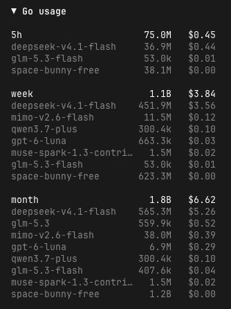
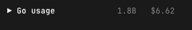

# opencode-go-usage

OpenCode TUI sidebar with your OpenCode Go token usage and cost per model, split into 5h, weekly and monthly windows.

| expanded | collapsed |
| :---: | :---: |
|  |  |

Click the `Go usage` header to collapse it; collapsed, it shows the current month totals.

## What it shows

Three blocks — `5h`, `week`, `month` — each with the window totals and one row per model, sorted by cost:

- **tokens** = input + cache read + cache write + output + reasoning
- **cost** = the cost OpenCode already recorded for that message; the plugin never recomputes prices

## Install

Needs [OpenCode](https://opencode.ai) (tested with 2.0.20) and [Bun](https://bun.sh) for the install step.

```sh
git clone https://github.com/aberigle/opencode-go-usage
cd opencode-go-usage
bun install
ln -s "$PWD" ~/.config/opencode/plugins/go-usage
```

Then restart OpenCode. To update: `git pull` in that directory, and `bun install` again if dependencies changed.

## How it works

Everything runs locally; the only network call is to fetch reset times.

- **Usage** comes from `~/.local/share/opencode/opencode.db`, opened read-only: it sums `cost` and `tokens.*` from `session_message` for `providerID = "opencode-go"`, grouped by model.
- **Windows** end at the real reset time when it's known, and otherwise on a rolling window ending now; the month window starts at the previous month's reset.
- **Reset times** come from `GET https://opencode.ai/zen/go/v1/usage`, authenticated with the OpenCode Go key OpenCode already stores locally. That key is read from the local database and only ever used for that one request. The result is cached for 10 minutes.
- **Refresh** is event-driven, no polling: it re-reads when OpenCode emits `session.usage.updated` or `session.usage.recorded`.
- **Off the main thread**: every SQLite read and the network call happen in a Worker.

Not shown: the account-level percentage the usage API reports. It is per account, not per model, so there is nothing meaningful to put next to a model row.

## License

MIT
